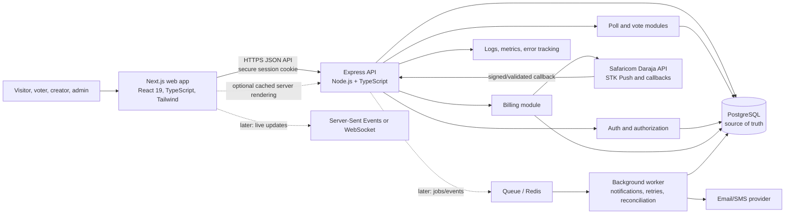
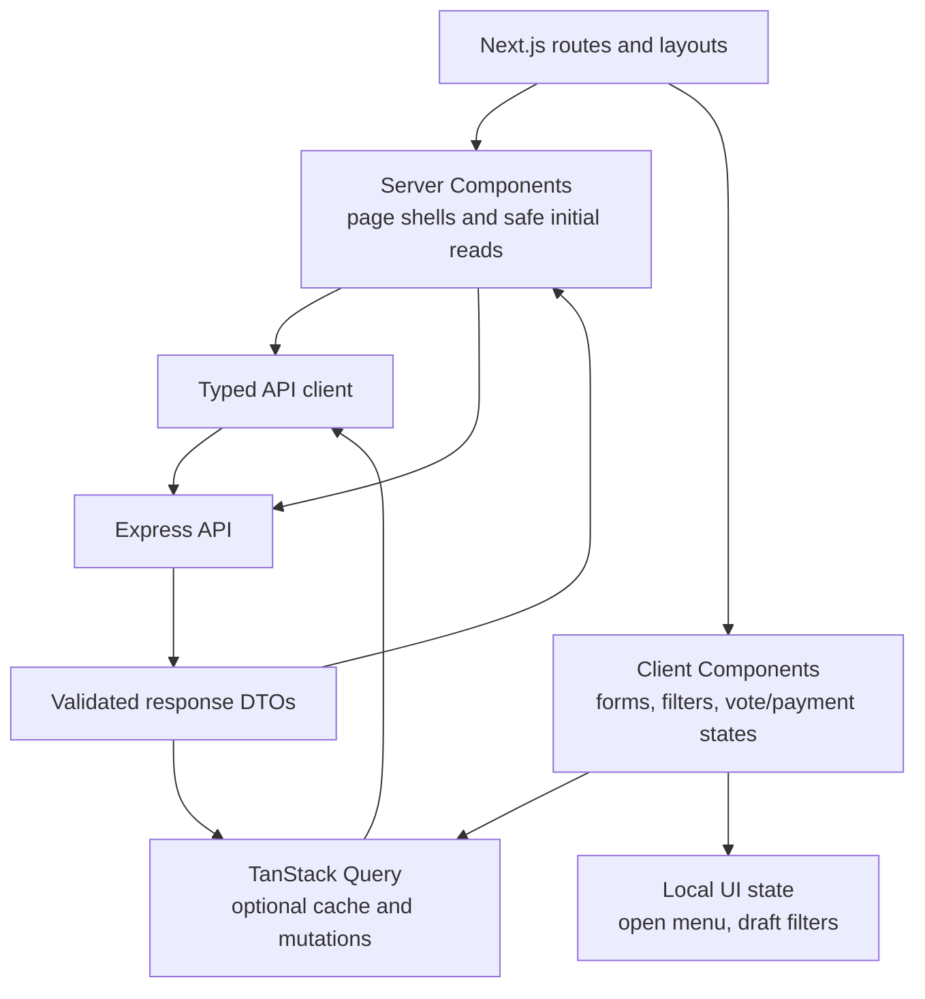
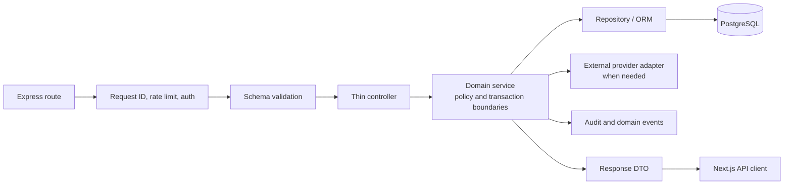
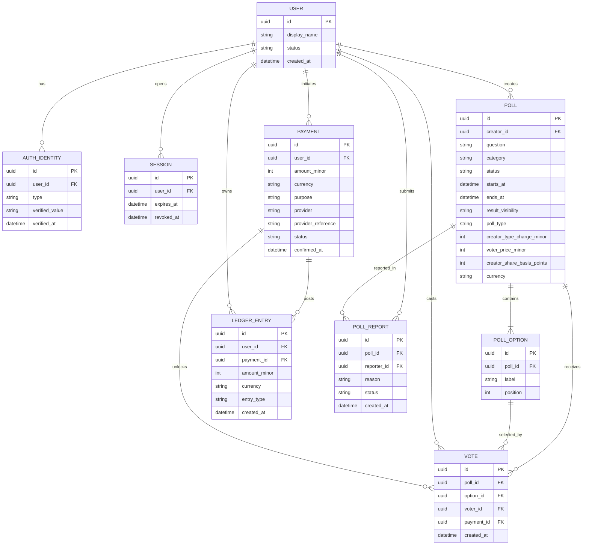
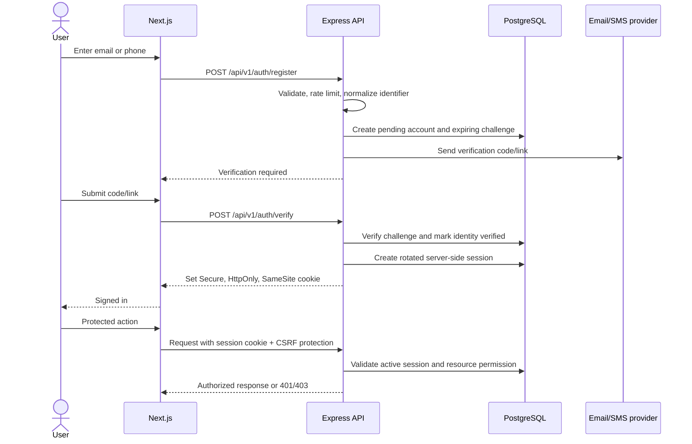
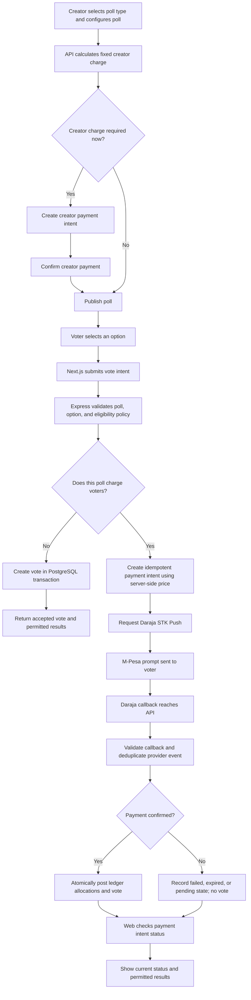
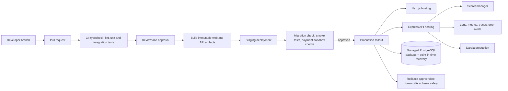

# Tally: Product and Engineering Plan

## 1. Purpose and Current State

Tally is a polling product initially aimed at Kenyan communities. The product direction visible in the prototype is public poll discovery, voting, creator workspaces, aggregate results, and KSh/M-Pesa monetization. Creators will choose from poll types with a fixed creator charge; a separate paid-poll model may charge voters an amount set by the creator, with a revenue share that is still being defined. This document turns that direction into an implementation plan; it is an architecture proposal, not a claim that the services below already exist.

### What the prototype currently contains

- `apps/web/src/app/page.tsx`: marketing-style entry page and a static sample result widget.
- `apps/web/src/app/polls/page.tsx`: API-backed discovery with client-side category/search/free-or-paid filtering.
- `apps/web/src/app/polls/[pollid]/page.tsx`: API-backed poll detail and persisted voting for eligible open-policy free polls.
- `apps/web/src/app/dashboard/page.tsx`: still contains mock creator metrics, balance, poll rows, and ledger entries.
- `apps/web/src/app/layout.tsx` and `apps/web/src/app/dashboard/layout.tsx`: global navigation, footer, and a desktop workspace sidebar.
- The web app is Next.js 16 with React 19, TypeScript, Tailwind CSS 4, and Lucide icons. Email/password identity now lives in the Express API; live M-Pesa processing is not implemented.

The landing-page preview and creator dashboard still contain illustrative data. Discovery, poll details, and open-policy free votes now use the API and PostgreSQL. Authentication and live payments are not implemented, so account-limited and paid votes are explicitly unavailable. The API, not the browser, is authoritative for poll and vote data.

### Runnable foundation added

The repository uses Bun workspaces, and the backend database boundary is owned by `apps/api/`:

- `apps/web/`: Next.js frontend, with poll discovery and poll detail connected to the API.
- `apps/api/src/features/`: feature-owned `routes.ts`, `service.ts`, and Zod `schema.ts` modules for auth, polls, votes, billing, and admin.
- `apps/api/src/db/`: PostgreSQL client, Drizzle schema, migrations, and repeatable demo seed data.
- `docker-compose.yml`: local PostgreSQL 17 service.

Feature convention: `schema.ts` contains Zod request validation; `routes.ts` maps HTTP endpoints; `service.ts` owns domain behavior and database transactions. Add `types.ts` only for reusable TypeScript contracts that are not already inferred from a Zod schema or Drizzle table.

The API implements health/readiness, email/password identity with email verification and password recovery, server-side sessions, poll discovery/CRUD/lifecycle/reporting, vote eligibility/casting/results, admin moderation/payment lookup/audit history, and basic billing intents/ledger reads. Creator-set prices and poll type fees are calculated server-side. M-Pesa is not wired: billing intents remain `created`, no payment is treated as successful, and voter-paid votes remain blocked until a provider is implemented. Open-policy free voting allows repeat votes when each request uses a new idempotency key; account-limited polls enforce one vote per account in PostgreSQL. Configure SMTP to send email in staging/production; local development prints verification/reset links to the API console.

Key endpoints include `POST /api/v1/auth/register`, `/verify-email`, `/login`, `/logout`, `/password/forgot`, `/password/reset`, plus `GET /api/v1/auth/me` and `/sessions`; `GET/POST /api/v1/polls`, `GET/PATCH /api/v1/polls/:pollId`, `POST /:pollId/publish`, `/close`, and `/reports`; `GET /api/v1/polls/:pollId/votes/eligibility`, `/me`, `/results`, and `POST /api/v1/polls/:pollId/votes`; billing at `/api/v1/billing/intents` and `/ledger`; and admin routes at `/api/v1/admin/reports`, `/polls/:pollId/moderation`, `/payments/:paymentId`, and `/audit`.

To make an existing account an administrator, set `ADMIN_EMAIL` in `.env` and run `bun run admin:promote`. That one-time role change is written to `audit_logs`; no public endpoint can grant admin privileges.

#### Run locally

Prerequisites: Bun 1.3+, Docker Compose, and Node.js 20+ for the Next.js app.

```sh
bun install
cp .env.example .env
docker compose up -d postgres
bun run db:generate
bun run db:migrate
bun run db:seed
bun run dev
```

The web app is at `http://localhost:3000`; the API is at `http://localhost:4001`. The credentials in `.env.example` are for local development only. Never reuse them outside a disposable local database. Use `docker compose down` to stop the database; its named volume retains local data.

When changing `apps/api/src/db/schema.ts`, run `bun run db:generate`, review and commit the generated migration under `apps/api/drizzle/`, then run `bun run db:migrate`. `bun run db:push` is available for disposable local prototyping, but committed migrations are the source of truth for shared environments. To grant an existing verified account admin access, set `ADMIN_EMAIL` in `.env` and run `bun run admin:promote`; the operation is recorded in the audit log.

## 2. Proposed Product Shape

### Main user roles

- **Visitor**: browse public polls and see whatever results the poll's visibility rules allow.
- **Voter**: cast an eligible vote, view permitted results, and manage account/privacy choices.
- **Creator**: create and manage polls, view analytics, and manage billing.
- **Administrator/support**: moderate reported content, handle account/payment support, and audit privileged actions.

One account may be both a voter and creator. Keep authorization based on explicit permissions and resource ownership, not on the frontend route or a role label alone.

### Important pages and data

| Page or area | Purpose | Main data and actions |
| --- | --- | --- |
| Home | Explain the product and direct people to discovery or sign-in | Featured/public polls; no sensitive data |
| Poll discovery (`/polls`) | Search and browse | Paginated poll summaries, category, status, close time, creator display name, current aggregate if public, fee indicator |
| Poll detail (`/polls/[pollid]`) | Read a poll, vote, share, see results | Poll, options, eligibility/fee rules, vote status for current user, aggregate results, close state |
| Sign-up/sign-in | Establish identity and session | Email/phone, verification challenge, session state, consent and terms version |
| Creator dashboard | Review owned polls and account activity | Owned polls, counts, trends, balance/plan summary, recent ledger activity |
| Create/edit poll | Configure and publish a poll | Question, options, category, start/end time, result visibility, creator-selected poll type and fixed type charge, optional voter price and proposed revenue-share terms, moderation state |
| Poll analytics | Understand performance | Time series and option aggregates, participation segments only where privacy thresholds permit |
| Billing/wallet | Pay and review charges | Plans/fees, payment attempts, provider references, immutable ledger entries, refunds/reversals |
| Account/settings | Manage identity and privacy | Verified contact methods, sessions, notification preferences, data export/deletion requests |
| Admin/moderation | Resolve reports and operational issues | Reports, moderation actions, audit trail, payment lookup; restricted staff access |

Treat aggregate analytics and identifiable voter information as separate data products. Creators should not receive voter phone numbers or individual choices by default.

## 3. System Architecture

Start with a **modular monolith**: one Express API, one PostgreSQL database, and a separate background worker only when asynchronous work is needed. This keeps transactions and deployment understandable while preserving clear module boundaries. Split services only after real scaling or operational evidence supports it.



**Request ownership:** the browser renders UI and collects input; the Express API authenticates, validates, authorizes, and applies business rules; PostgreSQL is the canonical record for accounts, polls, votes, payments, and ledger entries. The Daraja callback is an external claim that must be validated and reconciled before a payment is considered successful. Do not put Daraja credentials or privileged database access in the browser or Next.js client bundle.

## 4. Frontend Plan

### Technologies and responsibilities

- **Next.js App Router + React + TypeScript**: retain the current frontend. Use Server Components for read-only page shells and initial data where helpful; use Client Components for forms, filters, vote controls, payment status, and interactive charts.
- **Tailwind CSS 4 + existing Lucide icons**: continue with the current styling stack, but establish consistent design tokens, states, accessibility, and responsive behavior as screens are refined.
- **TanStack Query (recommended when API integration starts)**: use for browser-owned API reads and mutations that need cache invalidation, retries, pending/error states, pagination, or background refetching. It is not mandatory for static/server-rendered reads; avoid maintaining a duplicate client cache for every server fetch. Define a single typed API client and stable query keys.
- **Forms and validation**: use React Hook Form plus Zod if forms become multi-field or need shared client/server schemas; keep server-side validation authoritative. A smaller form can use native controls and Zod without adding both libraries immediately.
- **Charts**: choose a chart library when creator analytics are implemented; do not build analytics charts before the event/data model is settled.
- **Realtime**: launch with normal refetch after vote/payment and modest polling for payment status. Add SSE for result updates if usage justifies it; choose WebSockets only if there is a genuine bidirectional real-time need.

### Frontend interaction map



### Frontend implementation sequence

1. Refine the information architecture: public discovery, poll detail, auth, creator workspace, poll creation, analytics, billing, and settings.
2. Define shared TypeScript DTOs/API client and loading, empty, error, unauthorized, closed-poll, and payment-pending states.
3. Replace mock arrays in discovery/detail/dashboard with API data. Keep pagination and filters URL-addressable where useful.
4. Build poll creation/editing and accessible voting controls. Disable or explain actions according to server-returned eligibility, not frontend guesses.
5. Add auth/session UX and account settings; keep session material in secure, HTTP-only cookies rather than local storage.
6. Add billing screens and asynchronous payment status display after the payment API contract is stable.

## 5. Backend Plan

### Technologies and module boundaries

- **Node.js + Express + TypeScript**: the preferred API stack. Keep it as a separately deployable service from Next.js, with versioned `/api/v1` routes, request validation, centralized error handling, and OpenAPI documentation.
- **PostgreSQL + Drizzle ORM**: PostgreSQL is the canonical relational store; use Drizzle for typed schema definitions, queries, and committed migrations. Keep business rules and money calculations in domain services rather than ORM hooks.
- **Authentication**: the API foundation uses verified email/password login, Argon2id password hashes, hashed server-side session tokens in secure HTTP-only cookies, session revocation, and single-use verification/reset tokens. Apply authorization inside the API for every protected operation.
- **Redis/queue (later, optional)**: add for rate limits, short-lived coordination, job delivery, and fan-out only when needed. PostgreSQL remains the payment and vote record of truth.
- **M-Pesa Daraja**: isolate behind a billing/provider adapter so provider-specific tokens, callbacks, and response formats do not leak into poll logic.
- **Operational baseline**: structured logs with request/correlation IDs, metrics, error tracking, health/readiness endpoints, secrets management, and audit events for sensitive actions.

### Suggested API domains

| Domain | Representative operations | Rules to enforce server-side |
| --- | --- | --- |
| Identity | register, verify/resend contact, login/logout, current session, list/revoke sessions, request/reset password | Rate limits, hashed single-use expiring tokens, secure cookie sessions, non-enumerating recovery responses |
| Polls | list/search, detail/results, creator CRUD, publish/close, report | Ownership, moderator state, valid dates/options, creator type fee before publish, result visibility |
| Votes | check eligibility, cast vote, own vote, aggregate results | Per-poll policy, account uniqueness constraint, open window, option belongs to poll, idempotency, transactionality |
| Billing | create/read payment intent, list ledger | Server-calculated creator/voter amount, idempotency, ownership; provider remains disabled and intents stay `created` |
| Admin | review/dismiss/action reports, close/remove/restore polls, inspect payment, query audit log | Explicit admin permission, audited moderation actions, least privilege |

Use DTOs rather than exposing database rows. Return stable error codes, validate all input at the boundary, and use pagination for discovery and histories. Set CORS to the actual web origins; cookie-authenticated mutations require an allowed `Origin`, and use HTTPS everywhere. Feature-local `schema.ts` files contain Zod request schemas; add `types.ts` only for contracts that cannot be inferred from Zod or Drizzle.

### Core backend workflow



## 6. Data Model Proposal

Use UUID primary keys and UTC timestamps. Store money as integer minor units (for Kenya Shillings, whole KSh can be represented as integer shillings where the product does not accept sub-shilling amounts); store ISO currency separately. Never use floating-point numbers for money. Keep provider payloads minimized and access-restricted. Use Drizzle schema definitions and migrations as the source-controlled database contract.



This is a starting model, not a final schema. `poll_type` represents the creator-selected type and its fixed creator charge; `voter_price_minor` is optional and applies to voter-paid polls. The creator share is a proposed rate, not a settled financial rule; store the agreed terms used for each transaction so later configuration changes cannot rewrite historical accounting. If guest voting is required, create a privacy-reviewed voter identity/deduplication strategy rather than assuming one device equals one person. The product does not promise one vote per person: implement the selected eligibility and duplicate-vote policy consistently, and ensure the option belongs to the same poll. Whether votes are anonymous, public, or limited to verified users remains a product and privacy decision.

## 7. Key Workflows

### Authentication and session



Use expiring, single-use verification challenges; do not log codes or session secrets. Decide whether sign-in is passwordless OTP, password-based, or managed identity before implementation. SMS delivery adds cost and abuse risk, so apply throttling and monitoring. M-Pesa payment confirmation is not a substitute for account authentication.

### Voting and paid-vote flow



The creator's fixed poll-type charge and a voter-paid charge occur at different lifecycle points and may be cumulative: collect any creator charge at the agreed setup/publication point, then independently apply the poll's voter-payment rule when a vote is submitted. Whether every voter-paid poll also incurs the creator's fixed type charge is an open pricing decision. The creator/platform proceeds split for voter-paid polls is also undecided. Payment callback handling must be idempotent because providers may retry callbacks. Verify provider authenticity and expected merchant, amount, currency, phone/reference, and state; do not trust a browser redirect or client-provided success flag. Reconcile missing or ambiguous callbacks with Daraja. Persist callback data only as needed, redact sensitive fields, and restrict access. A database transaction plus unique constraints must prevent replayed callbacks or concurrent requests from creating duplicate ledger allocations or votes. Apply the chosen voting policy consistently; payment is not proof of one-person-one-vote.

### M-Pesa billing addition plan

The product has two distinct monetization mechanisms: (1) the creator chooses a poll type with a fixed creator charge; (2) a paid poll charges voters an amount chosen by the creator. Both mechanisms may apply to the same poll; confirm that pricing rule before implementation. For voter-paid polls, the creator may receive a share while the platform retains a percentage, but the split and related fees are not decided yet. Keep these as distinct payment purposes and ledger entries. Before implementation, decide when the creator charge is collected, the revenue split and its calculation basis, provider fees and tax treatment, payout timing, and the handling of failed/late payments, refunds, and reversals.

1. Confirm the poll types, fixed creator charge for each type, and when that charge is collected. Decide whether voter-paid polls also incur that fixed creator charge and whether both paths launch together.
2. Define the voter-paid poll terms before coding settlement: creator share, platform percentage, provider fees, tax treatment, rounding, refunds/reversals, and payout timing. Preserve the agreed terms against each transaction so later pricing changes do not rewrite history.
3. Create a Daraja sandbox application and confirm applicable STK Push, callback, settlement, reconciliation, and production onboarding requirements.
4. Implement provider credentials and token handling exclusively on the server, stored as deployment secrets with rotation and audit controls.
5. Introduce payment intents and explicit states (`created`, `pending`, `succeeded`, `failed`, `expired`, `reversed`); use distinct purposes for creator poll-type charges and voter-paid poll charges, with unique merchant references and idempotency keys.
6. Implement STK initiation, callback endpoint, callback authenticity checks, durable callback/event storage, duplicate suppression, and a provider status/reconciliation task.
7. Only on confirmed payment, atomically post the applicable ledger allocations and, for voter-paid polls, create the vote under the configured voting policy. Never treat a displayed balance as the accounting record.
8. Add payment status UI, receipt/reference history, support lookup, refund/reversal workflow, alerts for stale pending transactions, and operational dashboards.
9. Test in sandbox, then run a restricted production pilot with amount limits, alerting, reconciliation, and documented incident/refund procedures.

Get qualified local advice on consumer disclosures, tax, privacy/data protection, retention, payment-provider terms, and whether the chosen commercial model requires additional licensing or compliance. This plan is technical guidance, not legal or regulatory advice.

## 8. Deployment and Operations



### Deployment stages

- **Local development**: run web, API, and PostgreSQL with environment-specific configuration; keep secrets out of source control. Add migrations and seed data for a disposable local database.
- **CI**: on each pull request install from lockfiles, run formatting/lint, TypeScript checks, unit tests, API integration tests against PostgreSQL, and a production build. Scan dependencies and secrets.
- **Staging**: separate database and Daraja sandbox credentials; exercise migrations, signup, poll lifecycle, free/paid voting, retries, and callback behavior.
- **Production**: deploy web and API independently but compatibly, use managed PostgreSQL with automated backups and point-in-time recovery, TLS, secret management, health checks, rate limiting, and alerts. Choose hosting based on latency to Kenyan users, operational skills, availability, cost, and data requirements; verify actual regional support rather than assuming it.
- **Schema changes**: use expand/migrate/contract migrations so old and new app versions can overlap during deploy. Take and test backups before risky changes. Document rollback and payment incident procedures.
- **Reliability**: set service-level targets after measuring initial usage; monitor API latency/error rate, database saturation, payment callback delays/failures, duplicate/idempotency conflicts, and stuck pending payments.

## 9. Testing Plan

Testing can be staged, but testing fundamentals should begin with the first real API and database behavior.

- **Unit tests**: poll lifecycle rules, fee calculation, eligibility, vote uniqueness, payment state transitions, callback validation, and authorization policies.
- **API integration tests**: routes plus PostgreSQL migrations/constraints, session flows, owner permissions, transactions, idempotency, and callback retries. Use a Daraja adapter stub for deterministic tests.
- **Frontend component tests**: form validation, loading/error/empty states, disabled/closed polls, and payment pending/success/failure states.
- **End-to-end tests**: sign up, verify, create/publish a poll, cast a free vote, complete a sandbox paid-vote flow, inspect results and ledger, and verify unauthorized access is denied.
- **Security and resilience**: dependency/secret scans, authorization tests, rate-limit tests, CSRF checks, malformed/replayed callbacks, concurrent duplicate votes, provider timeouts, database restore drills, and accessibility checks.
- **Production checks**: synthetic health checks and payment reconciliation alerts; never run real charges in ordinary automated CI.

## 10. Recommended Delivery Phases

| Phase | Deliverable | Exit criteria |
| --- | --- | --- |
| 0. Product decisions | Define audience, guest/account voting, result visibility, identity/deduplication, moderation, and first revenue model | Written decisions and poll/vote/payment state diagrams agreed |
| 1. Foundation | Repo/API structure, environments, PostgreSQL migrations, CI, typed API contract, observability baseline | Staging web/API/database deploy; health checks and migration workflow work |
| 2. Identity and core polls | Registration/session, discovery, poll detail, creator CRUD, publish/close lifecycle | Users can authenticate and manage polls with API/database persistence and ownership checks |
| 3. Free voting and results | Eligibility, atomic unique vote, aggregates, result visibility, reporting/moderation basics | Concurrent duplicate vote tests pass; results match stored votes and visibility rules |
| 4. Creator workspace | Real dashboard, pagination, analytics baseline, account settings | All dashboard metrics derive from persisted records; privacy boundaries tested |
| 5. M-Pesa pilot | Separate creator poll-type charges and voter-paid poll intents, Daraja sandbox STK push/callback, allocation ledger, reconciliation, support tools | Monetization terms are approved; retries/replays do not double-charge/credit/vote; failure/reversal paths are tested |
| 6. Commercial launch | Production payment onboarding, billing disclosures, moderation operations, backup/restore and incident readiness | Restricted pilot meets operational, security, support, and compliance review gates |
| 7. Scale and polish | Realtime updates, queue/Redis if evidence supports them, analytics improvements, broader load/accessibility testing | Added systems solve measured bottlenecks and have runbooks/alerts |

The fastest sensible MVP is a reliable poll lifecycle with a creator-paid poll type where voting is free, followed by a controlled voter-paid poll pilot. Creator charges and paid voting both touch money and trust; implement each only after its charging, accounting, and support rules are clear.

## 11. Decisions to Resolve Before Building Billing

- Which poll types can creators choose, what fixed charge applies to each, and when is it collected? Does a voter-paid poll also incur the creator's poll-type charge?
- For voter-paid polls, what amount can the creator set, what share goes to the creator, what does the platform retain, and how do provider fees, taxes, refunds, rounding, and payouts work?
- Can visitors vote without an account? If yes, what privacy-preserving rule defines a unique voter and what abuse rate is acceptable?
- Are results visible before voting, after voting, or only after poll closure? Can a creator hide results?
- Are votes changeable or revocable? Can polls be edited after receiving votes?
- Which contact method is required, and is phone number retained for authentication, payment only, deduplication, or all three?
- What are the refund, failed-prompt, late-callback, reversal, and support policies?
- Who moderates polls and appeals, and what audit/retention policy applies?

Resolve these with user research and local payment/privacy/compliance advice; they define core data and trust boundaries, not just UI details.
